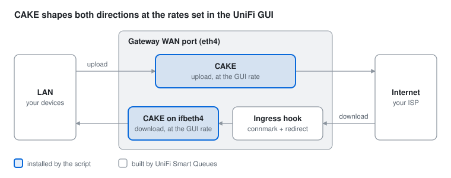

# CAKE shaping on UniFi gateways

UCG Ultra how-to, plus an untested UDM Pro adaptation.

Rohan Muscat, 16 November 2026. Download section added 17 November 2026.

## What this does

Both directions on the WAN are shaped by CAKE, and both rates are still set in the UniFi GUI under Smart Queues. Two small scripts on the gateway do the swap and keep it in place: `cake-upload` for the WAN port and `cake-download` for the device UniFi shapes download on. They are independent, so you can install upload only.

- **Tested on:** UniFi Cloud Gateway Ultra, firmware 6.0.17, kernel 5.4.213-ui-ipq5322, WAN on `eth4` with a plain IP (DHCP) connection, 500/50 Mbps service (GUI rates 570/57, the line is overprovisioned). Upload on 16 November 2026, download on 17 November 2026.
- **Not tested:** the UDM Pro section. It is an adaptation with checks that tell you early whether it will work.
- **Unsupported:** Ubiquiti does not support any of this. The SSH login banner warns that CLI modifications outside normal operation void the warranty.

Why bother: CAKE adds per-device fairness behind NAT and its own priority tiers. Upload is the direction that saturates first on an asymmetric link, and shaping 50 Mbps of it is light work for the gateway CPU.

Download shaping is the expensive direction. [Ubiquiti's own guidance](https://help.ui.com/hc/en-us/articles/12648661321367) is to avoid Smart Queues on connections of 300 Mbps or more, so on a fast link expect download shaping to cost CPU and possibly throughput. This setup keeps it anyway, by choice. See [Download CPU headroom](#download-cpu-headroom) before installing the download half.

## How it works

UniFi keeps building its normal Smart Queues shapers, and the scripts swap each one for CAKE at the same rate. The GUI stays the source of truth because each script reads the rate from the shaper UniFi just built.



Upload leaves through CAKE on the WAN port. Download arrives at UniFi's ingress hook and is redirected to `ifbeth4` exactly as stock, where CAKE now replaces UniFi's HTB + fq_codel.

What Smart Queues builds on the UCG Ultra (read from `tc` on the tested unit):

- **Upload, on the WAN port's outgoing side:** an HTB shaper. Its root class `1:1` carries the GUI upload rate, with two child classes (`1:2` default and `1:4` high priority), each feeding an fq_codel queue.
- **Download, on the WAN port's incoming side:** an ingress hook with one filter. It runs a `connmark` action, then redirects every packet to a virtual device named `ifb<wan>` (`ifbeth4` here). That device has its own HTB + fq_codel at the GUI download rate.

What each script does, once a minute:

1. Looks at the root queue on its device: the WAN port for upload, `ifbeth4` for download.
2. If it is `htb`, UniFi has just built or rebuilt its shaper. The script reads the rate from UniFi's HTB root class `1:1` and runs `tc qdisc replace` to put CAKE there at that rate.
3. If it is `cake`, it does nothing.
4. If it is anything else, Smart Queues is off in the GUI, and it does nothing.

The download script never touches the ingress hook itself. UniFi's redirect stays exactly as built.

Changing the upload figure in the GUI makes UniFi rebuild its HTB shaper, and the script converts it within a minute. This was observed during setup: after a GUI change the CAKE handle moved from `8003:` to `8004:` and its bandwidth followed the new figure.

If the script stops running, the gateway falls back to stock Smart Queues the next time UniFi applies its settings.

## UCG Ultra: preflight checks

Run these before installing anything. Each one confirms an assumption the script depends on.

**1. Smart Queues is on.** In the UniFi GUI, open the WAN's settings, enable Smart Queues and enter your upload and download rates. The minimum the GUI accepts for download is 1 Mbps, so download shaping cannot be switched off from there.

**2. SSH in as root** and find the WAN interface:

```bash
ip -br addr | grep -E 'eth|ppp'
```

The WAN is the interface holding your ISP address. On the tested unit it is `eth4`, with a companion `ifbeth4`. If a `ppp0` interface appears, the connection is PPPoE. See the limits section before going further.

**3. CAKE is available.** This tests the kernel module and the `tc` tool on an unused interface, so live traffic is not affected:

```bash
modprobe sch_cake; lsmod | grep cake
tc qdisc replace dev dummy0 root cake && tc qdisc show dev dummy0
tc qdisc del dev dummy0 root
```

Expected: a `sch_cake` line from `lsmod`, then a line starting `qdisc cake`. On firmware 6.0.17 both worked.

**4. The stock layout matches.** With Smart Queues on and no CAKE yet:

```bash
tc qdisc show dev eth4
tc class show dev eth4 | grep root
tc filter show dev eth4 parent ffff: | grep -i redirect
```

Expected, with a 50 Mbps upload setting:

```
qdisc htb 1: root refcnt 5 r2q 10 default 0x2 ...
class htb 1:1 root rate 50Mbit ceil 50Mbit burst 1500b cburst 1500b
        action order 2: mirred (Egress Redirect to device ifbeth4) stolen
```

The `class htb ... root rate` line is the one the script reads. If it is missing or looks different, stop here.

**5. Take a baseline.** Run a bufferbloat test (Waveform's is the common one) and note the speeds and latency grades, so you have something to compare against.
## UCG Ultra: install upload

One paste creates the script and the service, checks the script's syntax, and starts it. The script lives in `/data/cake-upload/` and the service unit in `/etc/systemd/system/`, with a spare copy of the unit kept in `/data`. The same two files are in this repo as `cake-upload.sh` and `cake-upload.service` if you would rather copy them across.

If your WAN is not `eth4`, change the `WAN_IF` line before pasting.

```bash
mkdir -p /data/cake-upload

cat << 'EOF' > /data/cake-upload/cake-upload.sh
#!/bin/bash
# cake-upload.sh
#
# What this does:
#   UniFi Smart Queues stays switched on in the GUI and remains the place
#   where the upload and download limits are set. Once a minute this script
#   checks the WAN port. If it finds UniFi's own upload shaper (HTB +
#   fq_codel) there, it:
#     1. reads the upload rate UniFi configured,
#     2. replaces that upload shaper with CAKE at the same rate.
#   If CAKE is already in place it changes nothing.
#   With fwmark, UniFi's own priority-app mark (0x8004, set by its DPI on
#   traffic leaving the WAN) puts those apps in CAKE's Voice tin, the same
#   as on download. Everything else is sorted into tins by DSCP.
#   Download is handled separately by cake-download.sh. Without it, UniFi
#   keeps shaping download with HTB + fq_codel on the ifb device.
#
# Fail-safe: if this script stops, UniFi's stock Smart Queues comes back
# the next time UniFi applies its settings (or at the next reboot).
#
# Logs: journalctl -t cake-upload   (only written when something changes)

WAN_IF="eth4"                 # WAN port to shape (check with: ip -br addr)
CAKE_OPTS="nat ethernet diffserv4 memlimit 64mb"
                              # nat           = per-device fairness behind NAT
                              # ethernet      = Ethernet frame overhead accounting
                              # diffserv4     = four priority tins from DSCP:
                              #                 Bulk, Best Effort, Video, Voice
                              # memlimit 64mb = queue memory cap (CAKE's default
                              #                 at 50 Mbit is 4 MB). A ceiling,
                              #                 not memory set aside.
                              # Optional: append ack-filter to thin redundant TCP
                              # ACKs on upload. Untested here, see the README first.
TIN_MASK=0x7fff               # mark bits CAKE reads as the tin number:
                              # 1 Bulk, 2 Best Effort, 3 Video, 4 Voice
CHECK_EVERY=60                # seconds between checks

log() { logger -t cake-upload "$*"; }

# Prints the type of the root (outgoing) qdisc on the WAN port: htb, cake, mq...
root_kind() {
    tc qdisc show dev "$WAN_IF" | awk '$4=="root"{print $2; exit}'
}

# Prints the upload rate UniFi set, taken from the line
#   "class htb 1:1 root rate 50Mbit ceil 50Mbit ..."
unifi_rate() {
    tc class show dev "$WAN_IF" | awk '
        $2=="htb" && $4=="root" {
            for (i=1; i<=NF; i++) if ($i=="rate") { print $(i+1); exit }
        }'
}

# Swap UniFi's upload shaper for CAKE at the same rate.
convert_upload() {
    local rate
    rate="$(unifi_rate)"
    # Refuse to act on anything that does not look like a rate (e.g. 50Mbit).
    if ! [[ "$rate" =~ ^[0-9]+(\.[0-9]+)?[KMG]?bit$ ]]; then
        log "could not read upload rate (got '$rate'), leaving UniFi shaper alone"
        return 1
    fi
    # Try with fwmark tins first; fall back without them on older kernels.
    if tc qdisc replace dev "$WAN_IF" root cake bandwidth "$rate" \
            $CAKE_OPTS fwmark "$TIN_MASK" 2>/dev/null; then
        log "upload now shaped by CAKE at $rate (fwmark tins on)"
    elif tc qdisc replace dev "$WAN_IF" root cake bandwidth "$rate" $CAKE_OPTS; then
        log "upload now shaped by CAKE at $rate (fwmark not supported)"
    else
        log "failed to apply CAKE, UniFi shaper left in place"
        return 1
    fi
}

while true; do
    case "$(root_kind)" in
        htb)  convert_upload ;;   # UniFi just (re)applied its shaper
        cake) : ;;                # already converted, nothing to do
        *)    : ;;                # Smart Queues off in the GUI, do nothing
    esac
    sleep "$CHECK_EVERY"
done
EOF

cat << 'EOF' > /data/cake-upload/cake-upload.service
[Unit]
Description=CAKE upload shaping for WAN1 (rate read from UniFi Smart Queues)
After=network-online.target

[Service]
Type=simple
ExecStart=/bin/bash /data/cake-upload/cake-upload.sh
Restart=always
RestartSec=30

[Install]
WantedBy=multi-user.target
EOF

bash -n /data/cake-upload/cake-upload.sh && \
cp /data/cake-upload/cake-upload.service /etc/systemd/system/ && \
systemctl daemon-reload && systemctl enable --now cake-upload
```

Notes on the design:

- **A loop** One long-running service that sleeps 60 seconds between checks writes nothing to the journal unless it changes something. A systemd timer would log a start and finish line every minute.
- **`/bin/bash` in `ExecStart`.** This runs the script without relying on execute permission under `/data`.
- **Same logic as the original install.** The script first installed on the tested unit also removed download shaping. That was switched off afterwards with `sed`, leaving an unused function in the file. The version above is the same behaviour with that function taken out. Running this install block over the top replaces it cleanly.

## UCG Ultra: install download

Optional, and independent of the upload half. Read [Download CPU headroom](#download-cpu-headroom) first.

One paste, same pattern as upload. The script lives in `/data/cake-download/`. The same two files are in this repo as `cake-download.sh` and `cake-download.service`.

If your WAN is not `eth4`, change the `WAN_IF` line before pasting. To put a WireGuard client tunnel into the Bulk tin, set `WG_IF` (see below).

```bash
mkdir -p /data/cake-download

cat << 'EOF' > /data/cake-download/cake-download.sh
#!/bin/bash
# cake-download.sh
#
# What this does:
#   UniFi Smart Queues stays switched on in the GUI and remains the place
#   where the download limit is set. UniFi shapes download on a virtual
#   device (ifb<wan>, e.g. ifbeth4) that its ingress hook redirects every
#   incoming WAN packet to. Once a minute this script checks that device.
#   If it finds UniFi's own HTB + fq_codel shaper there, it:
#     1. reads the download rate UniFi configured,
#     2. replaces that shaper with CAKE at the same rate.
#   If CAKE is already in place it changes nothing.
#
# Optional, off by default: put one WireGuard client tunnel into CAKE's
# Bulk tin, so bulk downloads through it give way to everything else.
# Set WG_IF to the tunnel's interface name (wg show) to turn it on.
#   - A mangle rule marks the tunnel's own UDP connection in conntrack.
#   - UniFi's ingress hook restores that connmark onto each download
#     packet before redirecting it to the ifb device.
#   - CAKE's fwmark option reads the low mark bits as a tin number:
#     1 = Bulk, 2 = Best Effort, 3 = Video, 4 = Voice.
#   UniFi's own priority-app mark (0x8004) sits in the same low bits and
#   lands in Voice. UniFi saves only the high mark bits (0x3ffe0000) to
#   conntrack, so the low bits used here do not collide with its routing
#   or VPN marks (checked on a UCG Ultra, firmware 6.0.17).
#
# Fail-safe: if this script stops, UniFi's stock Smart Queues comes back
# the next time UniFi applies its settings (or at the next reboot).
#
# Logs: journalctl -t cake-download   (only written when something changes)

WAN_IF="eth4"                 # WAN port (check with: ip -br addr)
IFB_IF="ifb${WAN_IF}"         # device UniFi redirects download traffic to
WG_IF=""                      # optional WireGuard client tunnel for Bulk,
                              # e.g. "wgclt2". Empty = feature off.
BULK_TIN=1                    # fwmark tin number for that tunnel (1 = Bulk)
TIN_MASK=0x7fff               # mark bits CAKE reads as the tin number
CAKE_OPTS="nat ethernet diffserv4 dual-dsthost ingress no-split-gso memlimit 128mb"
                              # nat           = see LAN addresses behind NAT
                              # ethernet      = frame overhead, same as upload
                              # diffserv4     = Bulk, Best Effort, Video, Voice
                              # dual-dsthost  = per-device fairness on download
                              # ingress       = count dropped packets against
                              #                 the rate (download mode)
                              # no-split-gso  = keep GRO-merged packets whole.
                              #                 A 64 KB lump is about 0.9 ms at
                              #                 570 Mbit, and splitting them is
                              #                 a large share of CAKE's CPU cost
                              # memlimit 128mb = queue memory cap, sized for
                              #                 many concurrent connections.
                              #                 A ceiling, not memory set aside.
CHECK_EVERY=60                # seconds between checks

log() { logger -t cake-download "$*"; }

# Prints the type of the root qdisc on the ifb device: htb, cake...
root_kind() {
    tc qdisc show dev "$IFB_IF" 2>/dev/null | awk '$4=="root"{print $2; exit}'
}

# Swap UniFi's download shaper for CAKE at the same rate.
convert_download() {
    local rate
    # UniFi's download rate is the ceil on its HTB root class 1:1
    rate=$(tc class show dev "$IFB_IF" classid 1:1 2>/dev/null |
           awk '{for (i = 1; i < NF; i++) if ($i == "ceil") {print $(i+1); exit}}')
    # Refuse to act on anything that does not look like a rate (e.g. 500Mbit).
    if ! [[ "$rate" =~ ^[0-9]+(\.[0-9]+)?[KMG]?bit$ ]]; then
        log "could not read download rate (got '$rate'), leaving UniFi shaper alone"
        return 1
    fi
    # Try with fwmark tins first; fall back without them on older kernels.
    if tc qdisc replace dev "$IFB_IF" root cake bandwidth "$rate" \
            $CAKE_OPTS fwmark "$TIN_MASK" 2>/dev/null; then
        log "download now shaped by CAKE at $rate (fwmark tins on)"
    elif tc qdisc replace dev "$IFB_IF" root cake bandwidth "$rate" $CAKE_OPTS; then
        log "download now shaped by CAKE at $rate (fwmark not supported)"
    else
        log "failed to apply CAKE, UniFi shaper left in place"
        return 1
    fi
}

# Mark the WireGuard tunnel's UDP connection so it lands in Bulk.
# UniFi rebuilds its iptables rules on provisioning, so re-add if missing.
ensure_bulk_mark() {
    [ -n "$WG_IF" ] || return 0                  # feature off
    local port
    port=$(wg show "$WG_IF" listen-port 2>/dev/null)
    [[ "$port" =~ ^[0-9]+$ ]] || return 0        # tunnel not up
    local rule=(-p udp --sport "$port" -j CONNMARK --set-xmark "$BULK_TIN/$TIN_MASK")
    if ! iptables -t mangle -C OUTPUT "${rule[@]}" 2>/dev/null; then
        iptables -t mangle -I OUTPUT 1 "${rule[@]}" &&
            log "bulk connmark rule added (udp sport $port -> tin $BULK_TIN)"
    fi
}

while true; do
    ensure_bulk_mark
    case "$(root_kind)" in
        htb)  convert_download ;;   # UniFi just (re)applied its shaper
        cake) : ;;                  # already converted, nothing to do
        *)    : ;;                  # Smart Queues off in the GUI, do nothing
    esac
    sleep "$CHECK_EVERY"
done
EOF

cat << 'EOF' > /data/cake-download/cake-download.service
[Unit]
Description=CAKE download shaping for WAN1 (rate read from UniFi Smart Queues)
After=network-online.target

[Service]
Type=simple
ExecStart=/bin/bash /data/cake-download/cake-download.sh
Restart=always
RestartSec=30

[Install]
WantedBy=multi-user.target
EOF

bash -n /data/cake-download/cake-download.sh && \
cp /data/cake-download/cake-download.service /etc/systemd/system/ && \
systemctl daemon-reload && systemctl enable --now cake-download
```

Notes on the options:

- **`memlimit`.** On the tested unit, UniFi's download fq_codel ran with a 4 MB memory limit. GRO merges incoming packets into lumps of up to about 64 KB (`maxpacket 69876` was recorded), so the 4 MB filled long before the 2000-packet limit did: 87,035 of 139,069 download drops were `drop_overmemory`, not normal queue management. `memlimit` is a ceiling, not memory set aside. 128 MB holds about 1.8 s of traffic at 570 Mbit, far more than CAKE lets build, and leaves room for bursts across many concurrent connections, so the cap should never be what drops a packet. Upload gets 64 MB for the same reason (CAKE's default at 57 Mbit is 4 MB).
- **`no-split-gso`.** CAKE normally splits those GRO lumps back into ~1500-byte packets, which multiplies its per-packet work at download rates. Keeping them whole costs at most one lump of serialisation, about 0.9 ms at 570 Mbit. That figure is arithmetic, not a measurement.
- **`dual-dsthost` and `nat`.** Per-device fairness on download. `nat` lets CAKE look up the LAN address behind NAT on the ifb device.
- **`ingress`.** CAKE's download mode, which counts dropped packets against the rate.
- **`fwmark 0x7fff`.** Lets a mark pick the CAKE tin. Both scripts try it first and fall back without it if the kernel refuses. It worked on firmware 6.0.17. On both directions, UniFi's DPI priority-app mark (`0x8004`) lands in Voice.

### Optional: a WireGuard tunnel in the Bulk tin

If you run bulk downloads through a WireGuard VPN client on the gateway, setting `WG_IF` puts that tunnel's traffic in CAKE's Bulk tin, so it soaks up spare capacity and gives way to everything else. Find the name with `wg show` (`wgclt2` on the tested unit).

How it works: the script adds one mangle rule that sets the low mark bits on the tunnel's own UDP connection. UniFi's ingress hook already runs a `connmark` action before the redirect, which copies that mark onto every download packet, and CAKE reads the low bits as the tin number (1 Bulk, 2 Best Effort, 3 Video, 4 Voice). UniFi saves only the high mark bits (`0x3ffe0000`) to conntrack, so the two don't collide. UniFi's own priority-app mark (`0x8004`) sits in the same low bits and lands in Voice.

On the tested unit the tunnel's conntrack mark became `0x21940001`: UniFi's WAN bits untouched, plus the 1. With the tunnel idle, the Bulk counter climbed by its handshake every 5 seconds.

The rule is not needed for the tunnel to work, and the script re-adds it if UniFi rebuilds its iptables rules.

## UCG Ultra: verify, test and tune

The install is working when CAKE is the root queue on the WAN port (and on `ifbeth4` if you installed download), the download redirect is still present, and each log shows one conversion line.

**1. Check the log:**

```bash
journalctl -t cake-upload
journalctl -t cake-download
```

Expected: `upload now shaped by CAKE at 57Mbit (fwmark tins on)` and `download now shaped by CAKE at 570Mbit (fwmark tins on)` (your rates). With `WG_IF` set there is also a `bulk connmark rule added` line.

**2. Check both directions:**

```bash
tc qdisc show dev eth4 | grep -E 'cake|ingress'
tc filter show dev eth4 parent ffff: | grep -i redirect
tc qdisc show dev ifbeth4
```

Expected, as seen on the tested unit with both halves installed:

```
qdisc cake 800a: root refcnt 5 bandwidth 57Mbit diffserv4 triple-isolate nat nowash no-ack-filter split-gso rtt 100ms noatm overhead 38 mpu 84 memlimit 64Mb fwmark 0x7fff
qdisc ingress ffff: parent ffff:fff1 ----------------
        action order 2: mirred (Egress Redirect to device ifbeth4) stolen
qdisc cake 800b: root refcnt 2 bandwidth 570Mbit diffserv4 dual-dsthost nat nowash ingress no-ack-filter no-split-gso rtt 100ms noatm overhead 38 mpu 84 memlimit 128Mb fwmark 0x7fff
```

With upload only, `ifbeth4` still shows UniFi's `qdisc htb 1: root` with two `fq_codel` leaves.

**3. Test the GUI link.** Change the upload or download figure in the GUI and apply. Within a minute the matching CAKE line should show the new bandwidth and a higher handle number (`8003:` became `8004:` in upload testing), and the log gains a line.

**4. Set the real rates.** The script uses the GUI figure as is.

- Run a speed test and note the measured upload and download.
- Set each GUI figure to roughly 90 to 95% of the measured value. That range is the usual rule of thumb for shapers, not something measured on this unit.
- A limit above what the line delivers means the shaper never becomes the bottleneck. The queue then builds at the ISP's rate limiter, where nothing manages it, and you get no latency benefit.

**5. Run the bufferbloat test again** and compare with the baseline.

**6. Confirm traffic is flowing through the download shaper.** Run this twice a few seconds apart during a download. The packet counts should climb, mostly in Best Effort:

```bash
tc -s qdisc show dev ifbeth4 | grep -E 'Bulk|pkts'
```

With `WG_IF` set, the Bulk count should climb whenever the tunnel is carrying traffic, and slowly from its handshakes when it is idle.

### Still to confirm on the tested unit

These had not been done when this was written:

- [ ] Reboot once, then repeat steps 1 and 2.
- [ ] Record bufferbloat results before and after.
- [ ] Measure the busiest core during a saturated download with CAKE on download (see the headroom section for the baseline).
- [ ] Confirm the Bulk tin gives way under real load, with the tunnel downloading at the same time as other traffic.
- [ ] Watch gateway CPU for a few days. Before the change, daily means were 24 to 37% with peaks of 97 to 100%.
- [ ] Check behaviour across a WAN failover event.
- [ ] Check the service after the next firmware update.

### Optional: ack-filter

CAKE has an option, `ack-filter`, that thins redundant TCP ACKs queued on the upload. It is off in this setup and untested here.

It is meant for links with very asymmetric rates. The authors of the CAKE patch do not recommend turning it on everywhere, because on more symmetrical links the effect is negligible at best. In their test on a 30/1 Mbps link it raised downstream throughput by about 20% (upstream by about 12% in the conservative mode) at the cost of about 5 ms of inter-flow latency ([patch notes](https://lore.kernel.org/all/20180522202241.GJ5488@localhost.localdomain/T/)). A 500/50 line is a much milder ratio, so a smaller gain is the likely outcome. That is an inference, nothing here measures it.

It has general drawbacks too. Filtering ACKs can interfere with ACK clocking, especially in slow start. In the conservative mode, which plain `ack-filter` selects, CAKE keeps at least two redundant ACKs in the queue and only filters redundant ones.

To try it, add the word to `CAKE_OPTS`, restart the service, then re-apply the upload figure in the GUI so UniFi rebuilds its shaper and the script converts it with the new options:

```bash
sed -i 's/^CAKE_OPTS="nat ethernet diffserv4 memlimit 64mb"/CAKE_OPTS="nat ethernet diffserv4 memlimit 64mb ack-filter"/' /data/cake-upload/cake-upload.sh
systemctl restart cake-upload
```

The CAKE line in `tc qdisc show dev eth4` then shows `ack-filter` where it showed `no-ack-filter`. To compare, run a large download while something else saturates the upload, with the option on and off, and watch download speed and latency. To undo it, reverse the `sed` and re-apply the GUI figure again.
### Download CPU headroom

CAKE on download is the heavy part of this setup, and CAKE runs as a single instance, so what matters is the busiest core, not the average.

Measured on the tested unit with UniFi's stock HTB + fq_codel on download, at about 535 Mbit/s: the whole gateway was about 41% busy and the busiest core 69%, nearly all of it packet processing. Scaled linearly, that core would be about 74% busy at 570 Mbit. The scaling is an assumption.

How much more CAKE costs than fq_codel varies by report:

- On a Raspberry Pi 4, one user found nearly identical results with CAKE and fq_codel ([OpenWrt forum](https://forum.openwrt.org/t/terrible-results-using-rpi4-sqm-to-control-buffer-bloat-anyone-else-with-this-setup-comment/104903?page=3)).
- The OpenWrt SQM docs note fq_codel giving about 15% higher throughput when CPU-limited ([OpenWrt docs](https://openwrt.org/docs/guide-user/network/traffic-shaping/sqm)).
- On a dual Cortex-A53 router, one user saw around 400 to 450 Mbit/s with CAKE against close to 600 with fq_codel ([OpenWrt forum](https://forum.openwrt.org/t/cerowrt-ii-would-anyone-care/110554/64)).
- The closest match, a quad Cortex-A53 IPQ8072A at 1.4 GHz, reached about 650 Mbit/s with CAKE after CPU affinity tuning and about 375 Mbit/s on stock settings ([OpenWrt forum](https://forum.openwrt.org/t/dynalink-dl-wrx36-askey-rt5010w-ipq8072a-technical-discussion/110454/2712)). The UCG Ultra's IPQ5322 is a quad Cortex-A53 at 1.5 GHz, and UniFi already spreads interrupts across cores.

Applying those ratios to the busiest core gives anywhere from about 74% to about 99% at 570 Mbit. Those are extrapolations from other hardware, not measurements on this unit. `no-split-gso` is there to pull the figure toward the low end. If CAKE runs short of CPU, it shapes worse rather than failing outright: latency rises under load and throughput drops. Measure before trusting it, and uninstall the download half if the busiest core sits near 100%.

## Persistence, firmware updates and uninstall

The services are enabled in systemd, so they should start at every boot and convert the shapers UniFi builds. Neither a reboot nor a firmware update had been tested on this unit at the time of writing.

**What lives where**

| Path | What it is |
| --- | --- |
| `/data/cake-upload/cake-upload.sh` | The script |
| `/data/cake-upload/cake-upload.service` | Spare copy of the service unit |
| `/etc/systemd/system/cake-upload.service` | The unit systemd runs |
| `/data/cake-download/cake-download.sh` | The download script |
| `/data/cake-download/cake-download.service` | Spare copy of the download unit |
| `/etc/systemd/system/cake-download.service` | The download unit systemd runs |

**Firmware updates.** One community guide, the [bufferbloat-lab UniFi chapter](https://github.com/filip-lebiecki/bufferbloat-lab/blob/main/docs/03-unifi.md), states that `/data` and `/etc` both survive firmware updates on UniFi OS. That has not been checked here. If a service is missing after an update, the spare copy in `/data` puts it back:

```bash
cp /data/cake-upload/cake-upload.service /etc/systemd/system/ && \
systemctl daemon-reload && systemctl enable --now cake-upload

cp /data/cake-download/cake-download.service /etc/systemd/system/ && \
systemctl daemon-reload && systemctl enable --now cake-download
```

The same guide warns that this kind of change can break on any firmware release. After each update, run the verify steps.

**Uninstall**

Upload:

```bash
systemctl disable --now cake-upload
rm -f /etc/systemd/system/cake-upload.service
rm -rf /data/cake-upload
systemctl daemon-reload
```

Download. The `iptables` line only matters if you set `WG_IF`. It removes the mark rule, so swap `wgclt2` for your tunnel's name:

```bash
systemctl disable --now cake-download
iptables -t mangle -D OUTPUT -p udp --sport "$(wg show wgclt2 listen-port)" -j CONNMARK --set-xmark 0x1/0x7fff
rm -f /etc/systemd/system/cake-download.service
rm -rf /data/cake-download
systemctl daemon-reload
```

Then re-apply the WAN settings in the GUI, or reboot, so UniFi rebuilds its stock shapers.
## UDM Pro: adaptation (untested)

The upload script should work on a UDM Pro with one variable changed, provided two checks pass: CAKE has to be usable from the stock `tc`, and Smart Queues has to build the same HTB layout. Nothing in this section has been run on a UDM Pro.

### What differs

|  | UCG Ultra (tested) | UDM Pro (from community reports, verify on yours) |
| --- | --- | --- |
| WAN interface | `eth4` | Usually `eth8` for the RJ45 WAN port; `ppp0` on PPPoE ([bufferbloat-lab](https://github.com/filip-lebiecki/bufferbloat-lab/blob/main/docs/03-unifi.md), [ataraxia.fyi](https://www.ataraxia.fyi/home/removing-smart-queue-on-unifi)) |
| Kernel | 5.4.213 | 4.19.152 as of firmware 1.10 in 2021 ([udm-kernel releases](https://github.com/fabianishere/udm-kernel/releases)). Current firmware not checked. |
| CAKE | Module and `tc` both work | Uncertain. This is the main risk, see below. |
| Smart Queues layout | HTB root class `1:1` carries the rate | Not confirmed. An ingress hook on the WAN port is reported, as on the Ultra. |
| Service manager | systemd | systemd on UniFi OS 2.0 and later. Firmware 1.x ran UniFi OS in a container and needs a different approach. |

### The CAKE risk

CAKE needs two things: the kernel module, and a `tc` binary new enough to configure it. On the UDM Pro these have not always come together.

- A 2021 [udm-kernel-tools issue](https://github.com/fabianishere/udm-kernel-tools/issues/21) shows `modprobe sch_cake` succeeding on a UDM Pro while `tc` answered `Unknown qdisc "cake"`. The maintainer pointed at the installed iproute2 (4.9.0), which predates CAKE support. That was firmware 1.10 with a custom kernel, so it may not reflect current firmware.
- The bufferbloat-lab guide says whether `sch_cake` is compiled in varies by model and firmware.

So test before anything else.

### Procedure

**1. Test CAKE.** `lo` is used here because a `dummy0` interface may not exist on the UDM Pro. The queue is removed again straight away:

```bash
uname -r
modprobe sch_cake; lsmod | grep cake
tc qdisc replace dev lo root cake && tc qdisc show dev lo
tc qdisc del dev lo root
```

| Result | Meaning | What to do |
| --- | --- | --- |
| `qdisc cake ...` is printed | Module and `tc` both support CAKE | Carry on |
| Module loads, `tc` says `Unknown qdisc` | The `tc` binary is too old | Stop. Fixing it means installing a newer iproute2 on the gateway, which is a bigger change than this guide covers. |
| `modprobe` fails | No CAKE module in this firmware | Stop. The only route is a custom kernel, which is not sensible on a production gateway. |

**2. Find the WAN interface and confirm the layout.** Smart Queues must be on in the GUI first:

```bash
ip -br addr | grep -E 'eth|ppp'
tc qdisc show dev eth8
tc class show dev eth8 | grep root
tc filter show dev eth8 parent ffff:
```

Swap `eth8` for whichever interface holds your ISP address. You need a `qdisc htb ... root` line and a `class htb ... root rate <your upload>` line. If the rate is not on an HTB root class, the script will not find it. It logs that and leaves the stock shaper alone.

**3. Install.** Use the UCG Ultra install block with the interface changed. Paste everything except the last three lines (the `bash -n` line onwards), then run:

```bash
sed -i 's/^WAN_IF="eth4"/WAN_IF="eth8"/' /data/cake-upload/cake-upload.sh
grep '^WAN_IF' /data/cake-upload/cake-upload.sh

bash -n /data/cake-upload/cake-upload.sh && \
cp /data/cake-upload/cake-upload.service /etc/systemd/system/ && \
systemctl daemon-reload && systemctl enable --now cake-upload
```

**4. Verify** with the UCG Ultra verify steps, using your interface names. The companion download device may be named differently, so list it with `ip -br link | grep ifb`.

The download script has not been considered for the UDM Pro at all. If you try it, set `WAN_IF` and check that `IFB_IF` matches what `ip -br link | grep ifb` shows, and that `tc class show dev <ifb> classid 1:1` prints a `ceil`.

### PPPoE

On PPPoE, shape `ppp0` and not the physical port, because the physical port only sees tunnelled frames and CAKE cannot tell flows or devices apart there.

- Set `WAN_IF="ppp0"` and run the layout check against `ppp0`.
- Change `CAKE_OPTS`. The `ethernet` keyword assumes plain Ethernet framing, and PPPoE adds its own header. Start with `CAKE_OPTS="nat"` and a slightly lower rate, then pick the right overhead keyword from the `tc-cake` man page for your access type.
- `ppp0` disappears and returns when the session reconnects. The script copes with that, since it re-checks every minute.

### Worth knowing

The ataraxia.fyi write-up reports that Smart Queues caps a UDM Pro at about 600 Mbps and cannot be enabled for upload alone from the controller. That matches the 1 Mbps download minimum seen on the Ultra. It is one person's report and the post gives no clear date.

## Known limits and troubleshooting

### Limits

- **Unsupported.** Ubiquiti can change the Smart Queues layout in any firmware release. If the HTB root class moves or is renamed, the script stops converting and logs why. Stock shaping carries on.
- **UniFi's priority lane is replaced.** The stock shapers have a small high-priority class (`1:4`), fed by UniFi's DPI marking certain apps with `0x8004`. Both scripts use `fwmark`, which maps that mark to CAKE's Voice tin. On upload the mark is set by a `POSTROUTING` rule before the packet reaches CAKE. The rule had marked about 17,000 packets since boot, but none during testing, so the Voice tin was not seen picking them up. Which apps UniFi marks was not investigated.
- **Up to a minute of stock shaping.** After a boot or any change that makes UniFi rebuild its shapers, each direction runs on HTB + fq_codel until its script's next check.
- **One WAN.** Only the interface named in `WAN_IF` is converted, in each script. A second WAN keeps stock Smart Queues.
- **Download CPU.** Download shaping, stock or CAKE, keeps every download packet on the CPU and out of the hardware offload. See the headroom section.
- **Rates read slightly lower.** CAKE counts Ethernet framing overhead (`overhead 38`) and UniFi's HTB did not, so at the same GUI figure speed tests read a little lower. Nudge the GUI figure up if it matters.
- **Access points are out of scope.** Wi-Fi queueing happens inside the radio driver, below where CAKE attaches.

### Troubleshooting

| Symptom | Check | Fix |
| --- | --- | --- |
| No CAKE on `ifbeth4` | `systemctl status cake-download` and `journalctl -t cake-download` | Service not running: use the re-enable commands. The download rate is read from the `ceil` on HTB class `1:1`, so check `tc class show dev ifbeth4 classid 1:1`. |
| No CAKE on the WAN port | `systemctl status cake-upload` and `journalctl -t cake-upload` | Service not running: use the re-enable commands. Log says it could not read the rate: Smart Queues is off, or the layout differs from the preflight. |
| CAKE shows the wrong rate | `tc qdisc show dev eth4` | Re-apply the upload figure in the GUI and wait a minute. |
| Tunnel traffic not in Bulk | `iptables -t mangle -S OUTPUT` and `conntrack -L -p udp` | The rule needs `WG_IF` set and the tunnel up. The tunnel's conntrack mark should end in `1` in its low bits. If the log said `fwmark not supported`, tins come from DSCP only. |
| Download is not being shaped | `tc filter show dev eth4 parent ffff:` shows no `Redirect` line | Reboot, or restore the filter by hand (below). |
| Log fills with repeated conversion lines | `journalctl -t cake-upload` | UniFi is rebuilding its shaper often. Harmless, but note what triggers it. |
| Upload latency no better than before | Compare the GUI upload figure with a speed test | Lower the GUI figure to below the measured upload. |

Restoring the download redirect by hand, as UniFi builds it on the Ultra (a `connmark` action, then the redirect):

```bash
tc filter del dev eth4 parent ffff:
tc filter add dev eth4 parent ffff: protocol all u32 match u32 0 0 \
  action connmark action mirred egress redirect dev ifbeth4
```

This was needed once during setup, after an early version of the script had removed the redirect.

## Sources

- [UniFi Gateway: Smart Queues](https://help.ui.com/hc/en-us/articles/12648661321367), Ubiquiti Help Center. The 300 Mbps guidance.
- [bufferbloat-lab, chapter 3: bufferbloat on UniFi](https://github.com/filip-lebiecki/bufferbloat-lab/blob/main/docs/03-unifi.md). WAN interface names, PPPoE, persistence claims. No test date or firmware version given.
- [udm-kernel-tools issue 21](https://github.com/fabianishere/udm-kernel-tools/issues/21). CAKE module loading but `tc` refusing it on a UDM Pro, 2021.
- [udm-kernel releases](https://github.com/fabianishere/udm-kernel/releases). UDM Pro kernel versions by firmware.
- [CAKE ACK filter patch notes](https://lore.kernel.org/all/20180522202241.GJ5488@localhost.localdomain/T/), Linux kernel mailing list. The ack-filter test results and recommendation.
- [OpenWrt SQM documentation](https://openwrt.org/docs/guide-user/network/traffic-shaping/sqm). fq_codel versus CAKE throughput when CPU-limited.
- OpenWrt forum threads on CAKE throughput: [RPi4](https://forum.openwrt.org/t/terrible-results-using-rpi4-sqm-to-control-buffer-bloat-anyone-else-with-this-setup-comment/104903?page=3), [dual Cortex-A53](https://forum.openwrt.org/t/cerowrt-ii-would-anyone-care/110554/64), [IPQ8072A](https://forum.openwrt.org/t/dynalink-dl-wrx36-askey-rt5010w-ipq8072a-technical-discussion/110454/2712). Individual user reports, not controlled benchmarks.
- [Removing download smart queue on UniFi UDM Pro](https://www.ataraxia.fyi/home/removing-smart-queue-on-unifi), ataraxia.fyi. UDM Pro interface name and throughput report.

Everything in the UCG Ultra sections comes from commands run on the tested unit between 12 and 17 November 2026, apart from the headroom section's outside figures.
